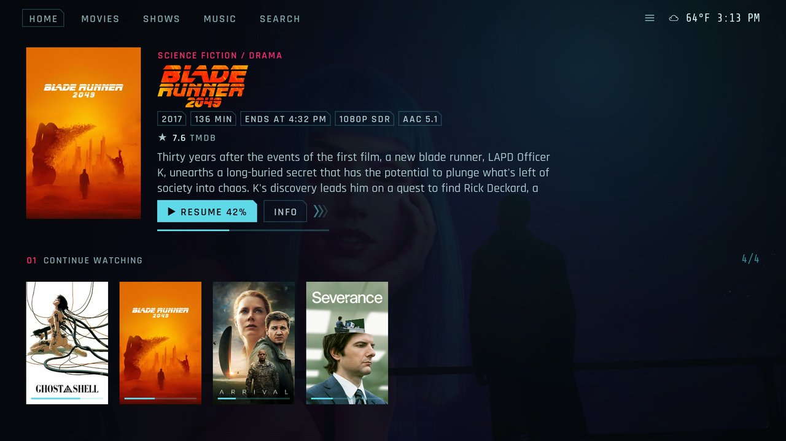
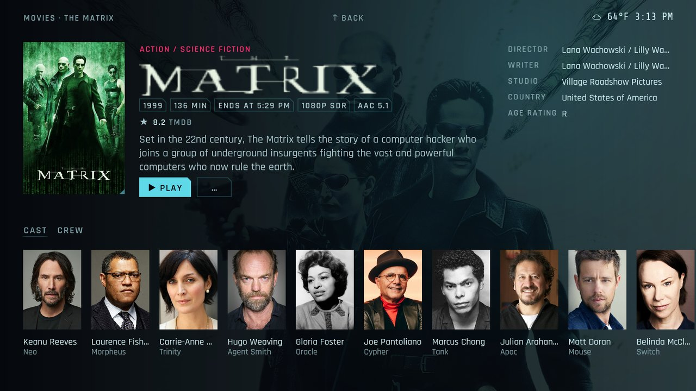
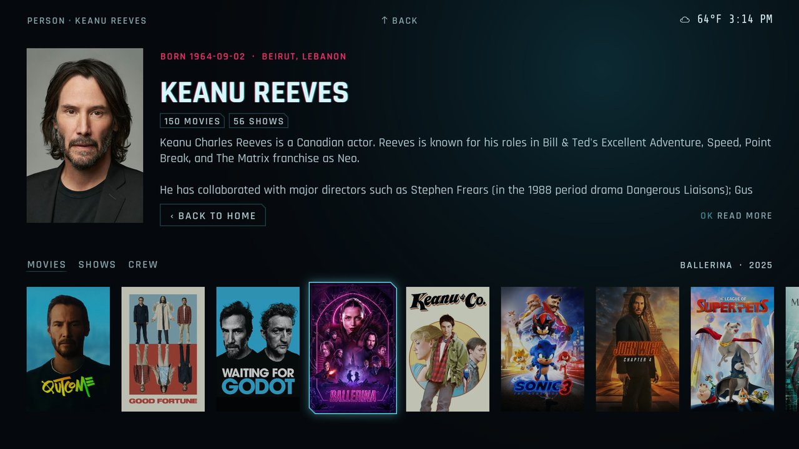
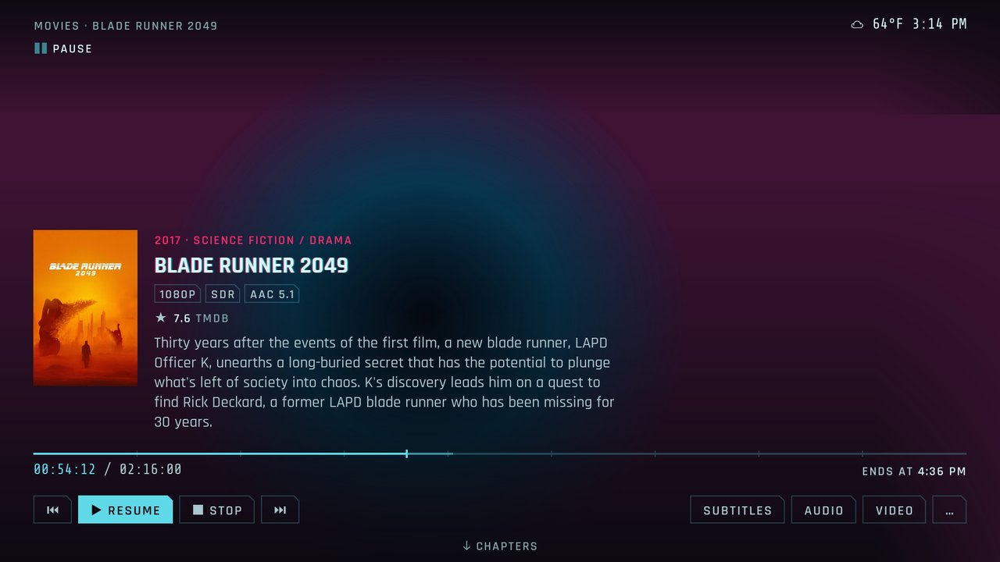

# Nightcity

A Kodi 21 skin with a calm cyberpunk look ("Netrunner"): dark backgrounds, cyan with pink accents, cut corners instead of framed boxes, and the artwork of your movies and shows in front.

Movies, shows and music: home with a spotlight and widget rows, the video and music libraries, info pages, playback and the dialogs Kodi needs. Ratings come from [TMDb Helper](https://github.com/jurialmunkey/plugin.video.themoviedb.helper), which is a required dependency.

The look is only half of it. The other half is easy use with a remote: few key presses to everything, pages and tabs that switch as the cursor moves, Back that returns to where you came from, and the same key doing the same thing on every page.

## Screenshots

| Home with the spotlight | Info page with cast and crew |
|---|---|
|  |  |
| **A person in a TMDb chain** | **Player, paused** |
|  |  |

More in Kodi's add-on browser: movies, music, settings and the quick menu. `tools/screenshots.py` takes them all again, see Development.

## Features

- Netrunner look: cut-corner cards and buttons, small spaced headings above the rows, a glitch title for the focused item, a path line at the top
- Home pages: home, movies, shows, search, system, power. The page switches as you move along the menu, no click needed. The fanart of the focused item fills the background, the hero shows its poster, tags, rating and plot
- Spotlight with random movies or shows: left on the play button goes back, right on the info button goes forward
- Rows: 8 slots per page (home, movies, shows) from a fixed catalogue in the skin settings (categories home, movies, shows): continue watching, next up, new movies, new episodes, genres, random movies, unwatched, top rated, favourites, TMDb trending, recently watched, sets, in progress; OK picks a section, right its option, "Move" reorders; spotlight per page (source, interval or off) and main menu entries to hide
- "all movies" / "all shows": a full poster grid, sortable by title, year, date added or rating
- Search page: a field for the keyboard, the last five terms, rows of library movies, shows and episodes and of TMDb movies and shows
- Settings console: the system page has one tile per group (playback and media, look and profiles, add-ons and content, system and network, tools). OK opens a rail with all settings entries under their group headings; the focused entry shows its categories on the right, and OK on one opens Kodi's page right at that category. Live TV shows up with a PVR client. Event log page
- Power page: device name, uptime, memory, address and temperature, tiles for power off, reboot, suspend, exit and restart (all but suspend ask first)
- Info page instead of a play/resume prompt: episodes show season tabs and the episode list with the clicked episode selected, resume and from start; movies show details, cast with photos and similar movies (TMDb Helper)
- Trailer on a movie's info page, also on a TMDb title in a chain: it plays in full screen over the page; Back ends it on its button, OK pauses, Left and Right seek. Most trailers are YouTube links: without the YouTube add-on the button offers to install it
- Back held on an info page goes back to where the browsing started, however deep the chain of people and titles is: the movie or episode page it started from (on the person it went on from), or the player's controls (play or resume) for a chain from the cast row. Kodi knows long presses only from keyboards and remotes that send keyboard keys (most IR and Bluetooth remotes); CEC and MCE remotes have none
- Player: thin seek bar with buffer, chapter ticks and a time bubble while seeking; OSD with play controls and stop, chapters, video settings, and track panels for subtitles and audio: move up from the button into the list, a click switches the track, the last row opens the full settings
- Music: a Music page on Home with an album spotlight and rows, album and artist pages, a player screen and a music OSD with the queue
- After an episode started from its info page stops, the info page comes back on the episode that played last
- Palettes: Netrunner (default), Tokyo Night, Catppuccin (Mocha)
- Fonts: Rajdhani for text, Share Tech Mono for numbers and times
- Focus glow on cards and buttons

## Usage notes

- On first start the skin sets Kodi's "Settings > Media > Videos > Default select action" to "Show information" once, so a click in the library opens the info page too. Change it back there if you prefer; the skin does not set it again.
- A click on a show opens the info page of its next episode: the started one, else the first unwatched, else the first.

## Install

Nightcity comes from the twiebe repository (https://github.com/twiebe/kodi-repo), which also keeps it up to date. It needs the TMDb Helper fork from the same repository (1:6.20.2-1 or newer): its window manager can go back to the first page of a chain, which Back held needs. That fork in turn needs modules that only jurialmunkey's repository carries in recent enough versions (the official Kodi repository has older ones), so that one goes in first.

1. Settings > File manager > Add source: `https://jurialmunkey.github.io/repository.jurialmunkey/`, and another one: `https://twiebe.github.io/kodi-repo/`
2. Settings > Add-ons > Install from zip file: `repository.jurialmunkey-<version>.zip` from the first source, then `repository.twiebe-<version>.zip` from the second
3. Add-ons > Install from repository > twiebe Repository > Look and feel > Skin > Nightcity > Install. Kodi installs the TMDb Helper fork with it (if jurialmunkey's TMDb Helper is installed, it asks to replace it: Yes, and keep its data) and offers to switch to the skin; later under Settings > Interface > Skin.

To try a build of your own, install its zip (`python tools/build.py`, see Development) with Install from zip file instead of step 3. Kodi updates an add-on only from where it was installed from: to get updates again, install Nightcity from the repository once more.

## Development

```
python -m venv .venv && .venv/bin/pip install -r requirements-dev.txt
.venv/bin/python -m pytest tests/static -q
.venv/bin/python -m pytest tests/unit -q
.venv/bin/python -m pytest tests/e2e -q -m e2e   # needs the kodi-dev environment, see tools/kodidev_setup.py
```

The e2e suite runs in parallel on a kodi-dev pool (several environments, each with its own Kodi and Jellyfin, see the kodi-dev README), one pytest-xdist worker per Kodi. The pool copies kodi-dev's `data/` as its template, so run `tools/kodidev_setup.py` before the first `pool up`: it also adds the titles the TMDb tests open. Each test run restarts the pool Kodis, so the skin's startup is the working tree's. `--dist loadfile` keeps each file on one Kodi, some files rely on their test order. `-m "e2e and not slow"` leaves out the tests that take more than 20 s.

```
/workspaces/kodi-dev/kdev pool up --skin "$PWD"   # this checkout in every worker
KDEV_POOL=1 .venv/bin/python -m pytest tests/e2e -q -m e2e -n auto --dist loadfile
```

`make screenshots` takes the screenshots in `resources/screenshots/` (listed in `addon.xml`, four of them above). It runs `tools/screenshots.py` in a container, so it needs only Docker and a kodi-dev checkout next to this one (`KODI_DEV`, default `../kodi-dev`) with its pool template (`tools/kodidev_setup.py`, then `kdev pool up` once). The script starts a kodi-dev instance of its own at 1920x1080 from the pool template, gives its library films and shows with their artwork from TMDb (internet access needed), opens each view and removes the instance again; about ten minutes. TMDb Helper fetches IMDb, Rotten Tomatoes and Metacritic ratings only with an API key: export yours as `MDBLIST_API_KEY` or `OMDB_API_KEY` for the run, the container gets them from the environment. Without them the pages show TMDb's rating.

```
make screenshots                                       # all eight
make screenshots KODI_DEV=/workspaces/kodi-dev SHOTS="info player" SCREENSHOTS_ARGS=--keep
MDBLIST_API_KEY=... make screenshots                   # with IMDb and the other ratings
.venv/bin/python tools/screenshots.py --instance shots info   # without the container (needs ffmpeg), on a kept instance
```

The container runs on the host network, since kdev publishes the instance's ports on 127.0.0.1 of the Docker host, and mounts both checkouts at their own paths, since kdev hands them to the same Docker daemon.

The player tests write a clip with two audio tracks, two subtitles and three chapters with `tools/make_tracks_clip.py` (needs ffmpeg).

## Credits

- [Arctic Fuse 3](https://github.com/jurialmunkey/skin.arctic.fuse.3) by jurialmunkey: the reference for the home layout and the TMDb Helper integration.
- [TMDb Helper](https://github.com/jurialmunkey/plugin.video.themoviedb.helper) by jurialmunkey: online movie and TV data.
- Cyberpunk 2077 by CD Projekt Red: the inspiration for the look; no assets are taken from it.
- [Rajdhani](https://fonts.google.com/specimen/Rajdhani) by Indian Type Foundry and [Share Tech Mono](https://fonts.google.com/specimen/Share+Tech+Mono) by Carrois Apostrophe, under the SIL Open Font License 1.1. `tools/make_fonts.py` builds the RetroUI fonts from Rajdhani plus symbols from [Noto Sans Symbols 2](https://fonts.google.com/noto/specimen/Noto+Sans+Symbols+2) and [JetBrains Mono](https://www.jetbrains.com/lp/mono/) (both OFL); RetroUI and RetroUIWide are renamed derivatives under the same license.
- Colour palettes after [Tokyo Night](https://github.com/folke/tokyonight.nvim) and [Catppuccin](https://catppuccin.com).
- Control ids follow Kodi's window code and Estuary; no Estuary layout is copied.

## License

[CC BY-NC-SA 4.0](https://creativecommons.org/licenses/by-nc-sa/4.0/), see [LICENSE.txt](LICENSE.txt). Fonts are under the SIL Open Font License 1.1.
